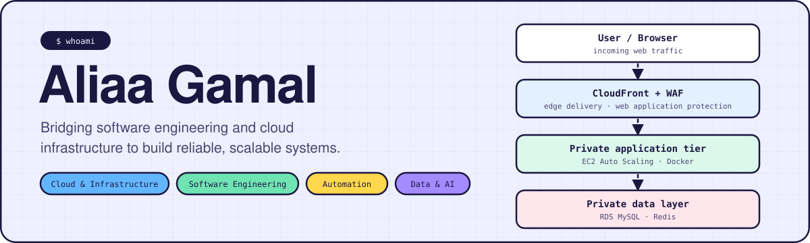
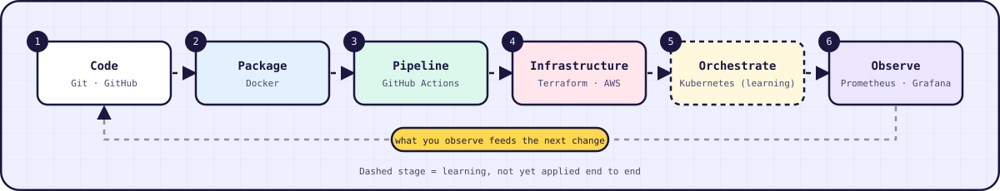
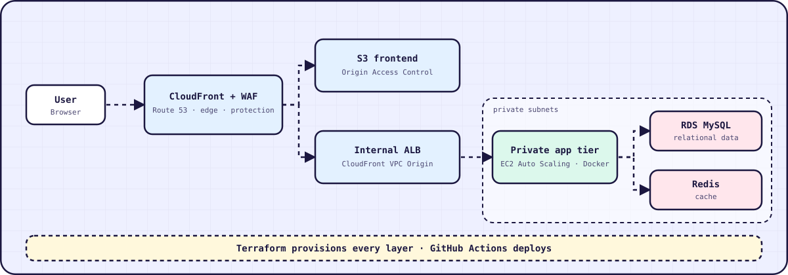
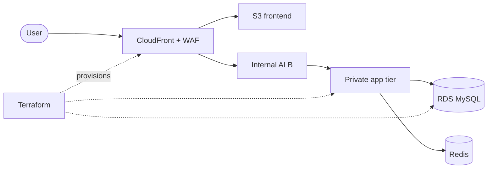
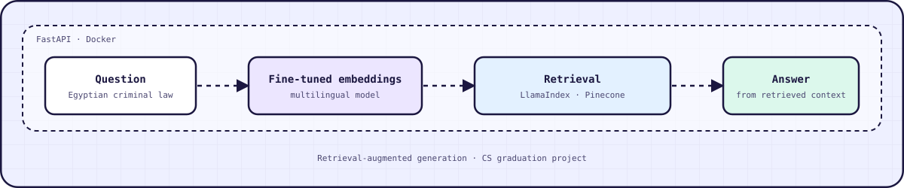
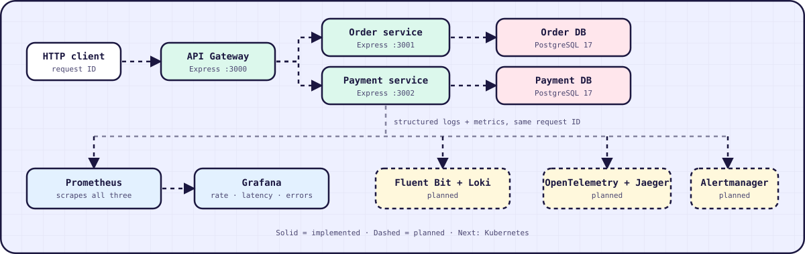

  

  

  
  
  
  
  

I bridge software engineering and cloud infrastructure to build reliable, scalable systems: infrastructure and networking, backend services, automation, and deployment. I graduated in Computer Science from Zagazig University in 2026 (GPA 3.7/4.0, with honors).

I like to own the whole path, so most of my projects start at the application code and end at the infrastructure it runs on. I work in small tested increments, secure every layer, automate delivery, add observability, and document decisions so the work is easy to review and hand over.

  

 

## Featured work

### RetailEdge

My NTI Cloud Operations graduation project: a multi-tier web application infrastructure designed around scalability, reliability, security, and repeatable deployments. The application and data layers are private behind CloudFront and WAF. Access follows least-privilege IAM (Secrets Manager, VPC endpoints, Systems Manager), infrastructure is defined in Terraform modules, and the app ships as Docker images through GitHub Actions with scripted validation.

  

Same diagram as editable Mermaid

**Stack:** AWS, Terraform, Docker, GitHub Actions, MySQL (RDS), Redis
**Code:** [Infrastructure](https://github.com/aliaagamall/retail-edge-aws) | [Application](https://github.com/aliaagamall/retailedge-app/tree/feat/retailedge-aws-integration)

### Verdict AI

A legal assistant for Egyptian criminal law, built as my CS graduation project. It answers questions and analyses cases with retrieval-augmented generation, using a fine-tuned multilingual embedding model, and exposes everything through a FastAPI API.

  

**Stack:** FastAPI, RAG, LlamaIndex, Pinecone, Docker

### PulseTrace (in progress)

A local-first microservices platform that simulates an e-commerce order flow across three Node.js services (API Gateway, Order and Payment), with a PostgreSQL database per service, SQL migrations, and Docker Compose with health checks and startup ordering. It has structured JSON logging (Pino) with request ID correlation across services, Prometheus metrics (request rate, latency histograms, error rate, business counters) in a provisioned Grafana dashboard, and automated tests across unit/API, end-to-end, integration, logging, and metrics layers, including tests that verify the observability layer itself. Next: centralized logging (Fluent Bit and Loki), distributed tracing (OpenTelemetry and Jaeger), alerting (Alertmanager), and Kubernetes.

  

**Stack:** Node.js, Express, PostgreSQL, Docker Compose, Pino, Prometheus, Grafana
**Code:** [GitHub](https://github.com/aliaagamall/pulsetrace)

 

<b>More projects</b> (cloud, reliability, distributed systems, data science)

 

| Project | What it is | Stack | Link |
| --- | --- | --- | --- |
| AWS Cloud Projects (in progress) | Hands-on AWS projects I rebuild while studying the Packt AWS Cloud Projects course on Coursera, each one designed, provisioned with IaC, tested, and documented | AWS, Terraform, CloudFormation | [GitHub](https://github.com/aliaagamall/cloud-projects) |
| Site Reliability Engineering (in progress) | Course notes, hands-on labs, diagrams, and examples on SLIs and SLOs, error budgets, observability, incidents, toil, and GitOps recovery | SRE, Observability | [GitHub](https://github.com/aliaagamall/site-reliability-engineering) |
| Test design for a sailing-rules method | Equivalence partitioning, statement coverage (JaCoCo), combinational testing, and random testing on a Java method | Java, TestNG, JaCoCo | [Report](https://drive.google.com/file/d/1KncfHyRIVb04JdmHhv6Ej6lNhTCK08Pe/view?usp=drivesdk) |
| Distributed Systems Research | Comparison of replication protocols (Primary-Backup, Chain Replication, CRAQ) with a SimPy simulation | Python, SimPy | [Document](https://docs.google.com/document/d/1DzpsZYGCqlCW_qIQgCOPHbceJzTQaZXg/edit?usp=drivesdk&ouid=106368767340190355862&rtpof=true&sd=true) |
| AI Financial Chatbot | RAG and generative AI app that turns financial data into natural-language answers | RAG, Generative AI | [GitHub](https://github.com/aliaagamall/ALCHATBOT_FINANCE) |
| Bank Customer Churn Prediction | ML model with an interactive Streamlit app and a Power BI dashboard | Scikit-learn, Streamlit, Power BI | [GitHub](https://github.com/aliaagamall/data_science_projects/blob/master/bank_customer_churn_prediction) |
| MediPredict | Ordinal classification app with SMOTE-based preprocessing and Flask deployment | Scikit-learn, Flask | [GitHub](https://github.com/aliaagamall/data_science_projects/tree/master/MediPredict) |
| Life Expectancy Prediction | Data preprocessing, model training, and Flask-based deployment | Flask, Scikit-learn | [GitHub](https://github.com/aliaagamall/data_science_projects/tree/13de533e67768e755f621fad10efaad2ef5340e9/life-expectancy) |
| Student Performance & Behavior Analysis | Exploratory and statistical analysis of student outcomes | Pandas, EDA | [Kaggle](https://www.kaggle.com/code/aliaagamal/student-performance-behavior-analysis) |
| Email Classification | NLP classifier for abusive and non-abusive email text | NLP, Scikit-learn | [Kaggle](https://www.kaggle.com/code/aliaagamal/email-classification) |

 

## Toolbox

**Cloud and infrastructure**

**CI/CD and automation**

**Observability**

Learning next, planned for PulseTrace:

  
  
  
  
  

**Backend**

**Data stores**

**AI and data**

 

## GitHub activity

  

  
  
  

  <picture>
    <source media="(prefers-color-scheme: dark)" srcset="https://raw.githubusercontent.com/aliaagamall/aliaagamall/output/github-contribution-grid-snake-dark.svg" />
    
  </picture>

 

## Now

I am adding observability to PulseTrace (logs, traces, alerting), building AWS projects from the Packt course, and studying SRE and DevSecOps. I am also preparing for the AWS Solutions Architect certification.

 

## Background

**Education**

- **B.Sc. in Computer Science**, Zagazig University, Faculty of Computers and Informatics (2022 to 2026). Graduated with honors, GPA 3.7/4.0
- **Cloud Services Management and Operation**, National Telecommunication Institute (NTI), Jun to Aug 2026. Technical and soft-skills training, final score 95%
- **Data Science Track**, Digital Egypt Pioneers Initiative (DEPI), Oct 2024 to Mar 2025
- **Machine Learning Training**, Information Technology Institute (ITI), Sep 2024

**Achievements and activities**

- [**Huawei ICT Competition 2025-2026, Cloud Track**](https://drive.google.com/file/d/1LJmSHjE_N4sUQ6BZV01MMa9bolD8EKrP/view?usp=drivesdk): represented Egypt in the Regional Phase after the national selection process
- [**Top 10 Finalist, DevFest Mansoura Hackathon**](https://drive.google.com/file/d/1qqIlc4yHGBIejg0-iQGVsKmuDpAbaDjU/view?usp=drivesdk) (Dec 2024), team CS Pioneers
- **GDG Lead:** guided students and supported their learning in technical topics

<b>Certifications</b>

 

**Cloud and DevOps**

- [Cloud Services Management and Operation, NTI](https://drive.google.com/file/d/1EH9XcdGXE-LQNCLYcCj3heAimKoUxGpX/view?usp=drivesdk)
- [AWS Academy Graduate, Cloud Foundations](https://www.credly.com/go/94eTPSa4)
- [Deploying on Amazon EKS, AWS Skill Builder Lab](https://drive.google.com/file/d/1-5BEwOM7shCZTnvaDcz3xPcH4CcQCNCM/view?usp=sharing)
- [DevOps Pro: Linux, Docker, Kubernetes, CI/CD & IaC, Specialization, Coursera](https://www.coursera.org/account/accomplishments/specialization/U15SV2S44G8C)
- [Observability Engineering: Metrics, Logs, and Traces, Coursera](https://coursera.org/share/9d45a6219d52560a53bf85a54254c5a1)
- [Infrastructure Automation (IaC) Hands-On Labs, KodeKloud](https://learn.kodekloud.com/learn/certificate/7a2c7267-d016-4868-b779-d04087f05226)
- [Mastering Docker Containers, Coursera](https://www.coursera.org/account/accomplishments/verify/9YDQ0I9T4PN7)
- [Mastering Docker & Containers Hands-On Labs, KodeKloud](https://learn.kodekloud.com/learn/certificate/c57a6f05-885d-4b0c-a563-057c6dc57b09)
- [Kubernetes Orchestration, Coursera](https://www.coursera.org/account/accomplishments/verify/Y8CHTP0VWNVW)
- [Kubernetes Hands-On Labs, KodeKloud](https://learn.kodekloud.com/learn/certificate/e9f33d76-da15-489e-9a51-38c079a2116f)
- [DevOps Foundation (Linux & Systems), Coursera](https://coursera.org/share/16bad8f6f939d85992485775d4246533)
- [Source Control & CI/CD, Coursera](https://coursera.org/share/f2597b7dcbbcf8f062acb996d32ab8e1)

**Systems and networking**

- [Red Hat System Administration I](https://drive.google.com/file/d/1LQLIjeOUEUwuvqglQKFzJnkOWLqm8SZ3/view?usp=drivesdk)
- [Ubuntu Linux Essentials](https://drive.google.com/file/d/16m7UFjil0QtMJu6OfxPsKeEyujaxAL_s/view?usp=drivesdk)
- [Computer Network Fundamentals](https://drive.google.com/file/d/1ugMF0f5ddFbatB7l1Sl8qzhzrm-J3-Q4/view?usp=drivesdk)
- [Implementation of Computer Network Fundamentals](https://drive.google.com/file/d/1XNoBXz5SVcBOL7UvuwZPuX0zjab78BG0/view?usp=drivesdk)
- [Introduction to Network Security](https://drive.google.com/file/d/1V-ngVs3Weo_3mWQIQXkN8NKkxqaq-yf8/view?usp=drivesdk)
- [IT Fundamentals and Hardware Essentials, Coursera](https://www.coursera.org/account/accomplishments/verify/EVXJ2U6VGGKC)

**Data science and AI**

- [DEPI, Data Science Track](https://drive.google.com/file/d/1FNJDYvnHhJQk577s3W3DJq4117pXEIOY/view?usp=drivesdk)
- [ITI, Machine Learning Program](https://drive.google.com/file/d/1n-po1YQficueXwVpGRutes2pXrQ__77H/view?usp=drivesdk)
- [Supervised Machine Learning, Coursera](https://www.coursera.org/account/accomplishments/verify/ZBUD7RA2M8LD)
- [Advanced Learning Algorithms, Coursera](https://www.coursera.org/account/accomplishments/verify/NUBXL57XRBGN)
- [5-Day Gen AI Intensive, Kaggle](https://www.kaggle.com/certification/badges/aliaagamal/96)
- [Intro to Deep Learning, Kaggle](https://www.kaggle.com/learn/certification/aliaagamal/intro-to-deep-learning)
- [Computer Vision, Kaggle](https://www.kaggle.com/learn/certification/aliaagamal/computer-vision)
- [Data Cleaning, Kaggle](https://www.kaggle.com/learn/certification/aliaagamal/data-cleaning)
- [TinyML, edX](https://courses.edx.org/certificates/2cabe3fb40104fe2a5521c1c729284ed)

 

  <i>From application code to cloud infrastructure: building reliable systems, one layer at a time.</i>

  

  

