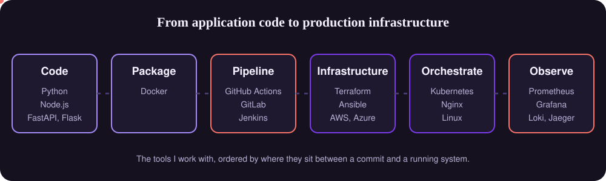
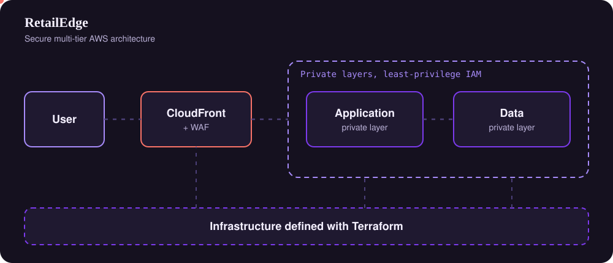
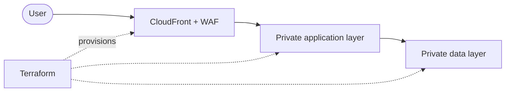
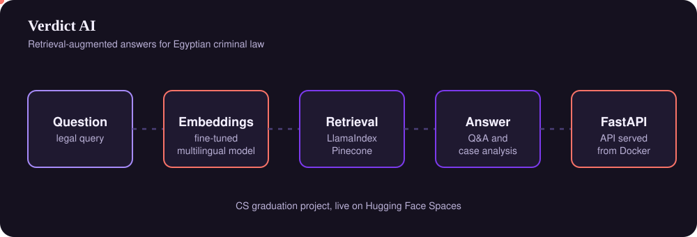
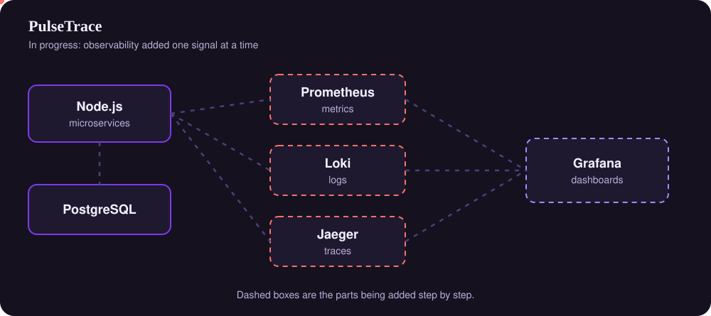

  

  

  
  
  
  

I design secure, scalable cloud systems and the applications that run on them: infrastructure and networking, backend services, automation, and deployment. I graduated in Computer Science from Zagazig University in 2026 (GPA 3.7/4.0, with honors).

I like to own the whole path, so most of my projects start at the application code and end at the infrastructure it runs on.

  

 

## Featured work

### RetailEdge

A secure multi-tier AWS architecture. The application and data layers are private and sit behind CloudFront and WAF. Access follows least-privilege IAM, infrastructure is defined in Terraform, and the app ships as Docker images through CI/CD.

  

Same diagram as editable Mermaid

**Stack:** AWS, Terraform, Docker, GitHub Actions
**Code:** [Infrastructure](https://github.com/aliaagamall/retail-edge-aws) | [Application](https://github.com/aliaagamall/retailedge-app)

### Verdict AI

A legal assistant for Egyptian criminal law, built as my CS graduation project. It answers questions and analyses cases with retrieval-augmented generation, using a fine-tuned multilingual embedding model, and exposes everything through a FastAPI API.

  

**Stack:** FastAPI, RAG, LlamaIndex, Pinecone, Docker

### PulseTrace (in progress)

A local-first microservices platform (API Gateway, Order and Payment services) built with Node.js, Express, and PostgreSQL, with a database per service and SQL migrations, containerized with Docker Compose using health checks and startup ordering. It has structured JSON logging (Pino) with request ID correlation across services, Prometheus metrics (request rate, latency histograms, error rate, business counters) in a provisioned Grafana dashboard, and automated tests across unit/API, end-to-end, integration, logging, and metrics layers. Next: centralized logging (Loki), distributed tracing (OpenTelemetry, Jaeger), alerting, and Kubernetes.

  

**Stack:** Node.js, Express, PostgreSQL, Docker Compose, Prometheus, Grafana
**Code:** [GitHub](https://github.com/aliaagamall/pulsetrace)

 

<b>More projects</b> (cloud, distributed systems, data science)

 

| Project | What it is | Stack | Link |
| --- | --- | --- | --- |
| AWS Cloud Projects | Hands-on implementations across AWS architecture, networking, security, compute, storage, and serverless | AWS, Terraform | [GitHub](https://github.com/aliaagamall/cloud-projects) |
| Distributed Systems Research | Comparison of replication protocols (Primary-Backup, Chain Replication, CRAQ) with a SimPy simulation | Python, SimPy | [Document](https://docs.google.com/document/d/1DzpsZYGCqlCW_qIQgCOPHbceJzTQaZXg/edit?usp=drivesdk&ouid=106368767340190355862&rtpof=true&sd=true) |
| AI Financial Chatbot | RAG and generative AI app that turns financial data into natural-language answers | RAG, Generative AI | [GitHub](https://github.com/aliaagamall/ALCHATBOT_FINANCE) |
| Bank Customer Churn Prediction | ML model with an interactive Streamlit app and a Power BI dashboard | Scikit-learn, Streamlit, Power BI | [GitHub](https://github.com/aliaagamall/data_science_projects/blob/master/bank_customer_churn_prediction) |
| MediPredict | Ordinal classification app with SMOTE-based preprocessing and Flask deployment | Scikit-learn, Flask | [GitHub](https://github.com/aliaagamall/data_science_projects/tree/master/MediPredict) |
| Life Expectancy Prediction | Data preprocessing, model training, and Flask-based deployment | Flask, Scikit-learn | [GitHub](https://github.com/aliaagamall/data_science_projects/tree/13de533e67768e755f621fad10efaad2ef5340e9/life-expectancy) |
| Student Performance & Behavior Analysis | Exploratory and statistical analysis of student outcomes | Pandas, EDA | [Kaggle](https://www.kaggle.com/code/aliaagamal/student-performance-behavior-analysis) |
| Email Classification | NLP classifier for abusive and non-abusive email text | NLP, Scikit-learn | [Kaggle](https://www.kaggle.com/code/aliaagamal/email-classification) |

 

## Toolbox

**Cloud and infrastructure**

**CI/CD and automation**

**Observability**

  
  
  
  
  

**Backend**

**Data stores**

**AI and data**

 

## GitHub activity

  

  
  
  

  <picture>
    <source media="(prefers-color-scheme: dark)" srcset="https://raw.githubusercontent.com/aliaagamall/aliaagamall/output/github-contribution-grid-snake-dark.svg" />
    
  </picture>

 

## Now

I am adding observability to PulseTrace and preparing for the AWS Solutions Architect certification.

 

## Background

**Education**

- **B.Sc. in Computer Science**, Zagazig University, Faculty of Computers and Informatics (2022 to 2026). Graduated with honors, GPA 3.7/4.0
- **Cloud Services Management and Operation**, National Telecommunication Institute (NTI). 3-month intensive training, final score 95%
- **AI & Data Science Track**, Digital Egypt Pioneers Initiative (DEPI). 6-month program
- **Machine Learning Program**, Information Technology Institute (ITI)

**Achievements and activities**

- [**Huawei ICT Competition 2025-2026 Egypt, Cloud Track**](https://drive.google.com/file/d/1LJmSHjE_N4sUQ6BZV01MMa9bolD8EKrP/view?usp=drive_link): qualified for the Regional Phase representing Egypt
- [**Top 10 Finalist, DevFest Mansoura Hackathon**](https://drive.google.com/file/d/1qqIlc4yHGBIejg0-iQGVsKmuDpAbaDjU/view?usp=drive_link) (Dec 2024), team CS Pioneers
- **GDG Lead:** guided students and supported their learning in technical topics

<b>Certifications</b>

 

**Cloud and DevOps**

- [Cloud Services Management and Operation, NTI](https://drive.google.com/file/d/1EH9XcdGXE-LQNCLYcCj3heAimKoUxGpX/view?usp=drivesdk)
- [AWS Academy Graduate, Cloud Foundations](https://www.credly.com/go/94eTPSa4)
- [Deploying on Amazon EKS, AWS Skill Builder Lab](https://drive.google.com/file/d/1-5BEwOM7shCZTnvaDcz3xPcH4CcQCNCM/view?usp=sharing)
- [DevOps Pro: Linux, Docker, Kubernetes, CI/CD & IaC, KodeKloud on Coursera](https://coursera.org/share/9eacb1818161d0659805bdaad13e6317)
- [Observability Engineering: Metrics, Logs, and Traces, Edureka on Coursera](https://coursera.org/share/9d45a6219d52560a53bf85a54254c5a1)
- [Mastering Docker Containers, Coursera](https://www.coursera.org/account/accomplishments/verify/9YDQ0I9T4PN7)
- [Kubernetes Orchestration, Coursera](https://www.coursera.org/account/accomplishments/verify/Y8CHTP0VWNVW)
- [DevOps Foundation, Coursera](https://coursera.org/share/16bad8f6f939d85992485775d4246533)
- [Source Control & CI/CD, Coursera](https://coursera.org/share/f2597b7dcbbcf8f062acb996d32ab8e1)
- [Hands-On Labs, KodeKloud](https://learn.kodekloud.com/learn/certificate/c57a6f05-885d-4b0c-a563-057c6dc57b09)
- [Kubernetes Hands-On Labs, KodeKloud](https://learn.kodekloud.com/learn/certificate/e9f33d76-da15-489e-9a51-38c079a2116f)

**Systems and networking**

- [Red Hat System Administration I](https://drive.google.com/file/d/1LQLIjeOUEUwuvqglQKFzJnkOWLqm8SZ3/view?usp=drivesdk)
- [Ubuntu Linux Essentials](https://drive.google.com/file/d/16m7UFjil0QtMJu6OfxPsKeEyujaxAL_s/view?usp=drivesdk)
- [Computer Network Fundamentals](https://drive.google.com/file/d/1ugMF0f5ddFbatB7l1Sl8qzhzrm-J3-Q4/view?usp=drivesdk)
- [Implementation of Computer Network Fundamentals](https://drive.google.com/file/d/1XNoBXz5SVcBOL7UvuwZPuX0zjab78BG0/view?usp=drivesdk)
- [Introduction to Network Security](https://drive.google.com/file/d/1V-ngVs3Weo_3mWQIQXkN8NKkxqaq-yf8/view?usp=drivesdk)
- [IT Fundamentals and Hardware Essentials, Coursera](https://www.coursera.org/account/accomplishments/verify/EVXJ2U6VGGKC)

**Data science and AI**

- [DEPI, Data Science Track](https://drive.google.com/file/d/1FNJDYvnHhJQk577s3W3DJq4117pXEIOY/view?usp=drivesdk)
- [ITI, Machine Learning Program](https://drive.google.com/file/d/1n-po1YQficueXwVpGRutes2pXrQ__77H/view?usp=drivesdk)
- [Supervised Machine Learning, Coursera](https://www.coursera.org/account/accomplishments/verify/ZBUD7RA2M8LD)
- [Advanced Learning Algorithms, Coursera](https://www.coursera.org/account/accomplishments/verify/NUBXL57XRBGN)
- [5-Day Gen AI Intensive, Kaggle](https://www.kaggle.com/certification/badges/aliaagamal/96)
- [Intro to Deep Learning, Kaggle](https://www.kaggle.com/learn/certification/aliaagamal/intro-to-deep-learning)
- [Computer Vision, Kaggle](https://www.kaggle.com/learn/certification/aliaagamal/computer-vision)
- [Data Cleaning, Kaggle](https://www.kaggle.com/learn/certification/aliaagamal/data-cleaning)
- [TinyML, edX](https://courses.edx.org/certificates/2cabe3fb40104fe2a5521c1c729284ed)

 

  <i>From application code to cloud infrastructure: building reliable systems, one layer at a time.</i>

  

  

